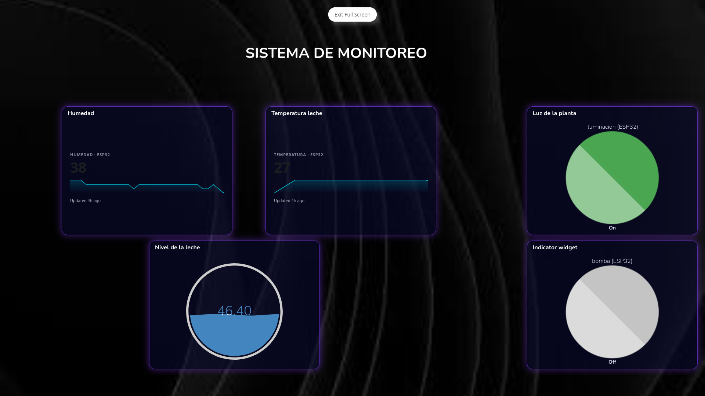

# LactoBytes

LactoBytes es un proyecto IoT escrito en Micropython con ESP32 de un sistema de monitoreo de una fabrica de leche.

### Dashboard en Stem Ubidots


### Clases principales
#### ActuatorController

```Python
# =====================================================================
# actuator_controller.py - Clase ActuatorController
# Contiene la lógica de decisión y el control de las salidas:
# relé + mini bomba, servomotor (ventilador), LEDs de criticidad e
# iluminación perimetral.
# =====================================================================
from machine import Pin, PWM
import time
import config

# Estados de criticidad térmica
ESTABLE = 0      # LED verde
ALERTA = 1       # LED amarillo
CRITICO = 2      # LED rojo
NOMBRE_ESTADO = {ESTABLE: "ESTABLE", ALERTA: "ALERTA", CRITICO: "CRITICO"}


class ActuatorController:

    def __init__(self):
        self._rele = Pin(config.PIN_RELE, Pin.OPEN_DRAIN, value=1)
        self._servo = PWM(Pin(config.PIN_SERVO), freq=50)
        self._led_verde = Pin(config.PIN_LED_VERDE, Pin.OUT, value=0)
        self._led_amarillo = Pin(config.PIN_LED_AMARILLO, Pin.OUT, value=0)
        self._led_rojo = Pin(config.PIN_LED_ROJO, Pin.OUT, value=0)
        self._luz = Pin(config.PIN_LUZ_PERIMETRAL, Pin.OUT, value=0)

        self.estado = ESTABLE
        self.bomba_encendida = False
        self.ventilador_encendido = False
        self.luz_encendida = False
        self.alarma_desborde = False
        self._angulo = 0
        self._sentido = 1

        self.apagar_bomba()
        self.mover_servo(0)

    # ------------------------------------------------------------------
    # Etapa de potencia: relé -> mini bomba de agua
    # ------------------------------------------------------------------
    def _escribir_rele(self, encender):
        if config.RELE_ACTIVO_EN_BAJO:
            self._rele.value(0 if encender else 1)
        else:
            self._rele.value(1 if encender else 0)

    def encender_bomba(self):
        self._escribir_rele(True)
        self.bomba_encendida = True

    def apagar_bomba(self):
        self._escribir_rele(False)
        self.bomba_encendida = False

    def controlar_nivel(self, nivel_pct):
        """Control ON/OFF con histéresis para el trasvase de leche."""
        if nivel_pct is None:
            self.apagar_bomba()             # Sin lectura confiable: seguro
            return
        self.alarma_desborde = nivel_pct >= config.NIVEL_DESBORDE_PCT
        if self.alarma_desborde or nivel_pct >= config.NIVEL_ALTO_PCT:
            self.apagar_bomba()
        elif nivel_pct <= config.NIVEL_BAJO_PCT:
            self.encender_bomba()
        # Entre los dos umbrales se mantiene el estado anterior

    # ------------------------------------------------------------------
    # Servomotor (PWM 50 Hz): pulso de 0.5 ms (0°) a 2.5 ms (180°)
    # ------------------------------------------------------------------
    def mover_servo(self, angulo):
        angulo = max(0, min(180, angulo))
        pulso_us = 500 + angulo * 2000 / 180
        self._servo.duty_u16(int(pulso_us * 65535 / 20000))
        self._angulo = angulo

    def paso_ventilador(self):
        """Barrido de 0° a 180° y regreso, simulando las aspas del enfriador."""
        nuevo = self._angulo + 45 * self._sentido
        if nuevo >= 180 or nuevo <= 0:
            self._sentido *= -1
        self.mover_servo(nuevo)

    # ------------------------------------------------------------------
    # Criticidad térmica: verde / amarillo / rojo
    # ------------------------------------------------------------------
    def evaluar_temperatura(self, temperatura, sensor_en_falla=False):
        h = config.HISTERESIS_TEMP
        if sensor_en_falla or temperatura is None:
            # Falla del sensor: se asume lo peor (enfriar y alertar)
            self.estado = CRITICO
        elif temperatura >= config.TEMP_CRITICA:
            self.estado = CRITICO
        elif temperatura >= config.TEMP_ALERTA:
            # Si venía de crítico, solo baja cuando cae bajo el umbral - h
            if self.estado == CRITICO and temperatura > config.TEMP_CRITICA - h:
                self.estado = CRITICO
            else:
                self.estado = ALERTA
        else:
            if self.estado != ESTABLE and temperatura > config.TEMP_ALERTA - h:
                self.estado = ALERTA        # Histéresis: aún no es estable
            else:
                self.estado = ESTABLE

        self._led_verde.value(1 if self.estado == ESTABLE else 0)
        self._led_amarillo.value(1 if self.estado == ALERTA else 0)
        self._led_rojo.value(1 if self.estado == CRITICO else 0)

        # El enfriamiento se activa en ALERTA y en CRITICO
        self.ventilador_encendido = self.estado != ESTABLE
        if self.ventilador_encendido:
            self.paso_ventilador()
        else:
            self.mover_servo(0)
        return self.estado

    # ------------------------------------------------------------------
    # Iluminación perimetral: oscuridad (LDR) u horario nocturno
    # ------------------------------------------------------------------
    @staticmethod
    def es_horario_nocturno():
        anio = time.localtime()[0]
        if anio < 2024:                     # Reloj sin sincronizar
            return False
        hora = (time.localtime()[3] + config.ZONA_HORARIA) % 24
        return hora >= config.HORA_INICIO_NOCHE or hora < config.HORA_FIN_NOCHE

    def controlar_iluminacion(self, luz_pct):
        oscuro = luz_pct is not None and luz_pct < config.LUZ_OSCURO_PCT
        noche = config.USAR_HORARIO_NOCTURNO and self.es_horario_nocturno()
        self.luz_encendida = oscuro or noche
        self._luz.value(1 if self.luz_encendida else 0)

    # ------------------------------------------------------------------
    def a_diccionario(self):
        return {
            "estado": self.estado,
            "bomba": 1 if self.bomba_encendida else 0,
            "ventilador": 1 if self.ventilador_encendido else 0,
            "iluminacion": 1 if self.luz_encendida else 0,
            "desborde": 1 if self.alarma_desborde else 0,
        }
```
#### SensorData

```Python
# =====================================================================
# sensor_data.py - Clase SensorData
# Encapsula la lectura de todos los sensores (DHT11, HC-SR04 y LDR),
# aplica filtros para descartar lecturas anómalas y empaqueta los
# resultados en un diccionario de Python listo para enviar a la nube.
# =====================================================================
from machine import Pin, ADC, time_pulse_us
import time
import dht
import config


class SensorData:

    def __init__(self):
        # --- Sensor de temperatura ---
        pin_dht = Pin(config.PIN_DHT)
        if config.TIPO_SENSOR_TEMP == "DHT22":
            self._dht = dht.DHT22(pin_dht)
        else:
            self._dht = dht.DHT11(pin_dht)

        # --- Sensor ultrasónico ---
        self._trig = Pin(config.PIN_TRIG, Pin.OUT, value=0)
        self._echo = Pin(config.PIN_ECHO, Pin.IN)

        # --- Fotorresistencia (ADC de 12 bits, rango 0-3.3 V) ---
        self._ldr = ADC(Pin(config.PIN_LDR))
        self._ldr.atten(ADC.ATTN_11DB)

        # --- Estado interno (encapsulado) ---
        self._historial_temp = []
        self._fallas_temp = 0
        self.temperatura = None
        self.humedad = None
        self.distancia_mm = None
        self.nivel_mm = None
        self.nivel_pct = None
        self.luz_pct = None

    # ------------------------------------------------------------------
    # Temperatura: lectura + validación de rango + media móvil
    # ------------------------------------------------------------------
    def leer_temperatura(self):
        try:
            self._dht.measure()
            t = self._dht.temperature()
            h = self._dht.humidity()
            # El DHT11 mide de 0 a 50 °C: lo que esté fuera es una falla
            if t is None or t < 0 or t > 50:
                raise ValueError("Lectura fuera de rango")
            self._historial_temp.append(t)
            if len(self._historial_temp) > config.MUESTRAS_FILTRO:
                self._historial_temp.pop(0)
            self.temperatura = sum(self._historial_temp) / len(self._historial_temp)
            self.humedad = h
            self._fallas_temp = 0
        except Exception as e:
            self._fallas_temp += 1
            print("[SensorData] Error DHT:", e)
        return self.temperatura

    def sensor_temp_en_falla(self):
        """True si el sensor térmico falló 3 veces seguidas."""
        return self._fallas_temp >= 3

    # ------------------------------------------------------------------
    # Nivel: pulso de 10 us en TRIG, tiempo del eco y mediana de muestras
    # distancia = (tiempo * velocidad del sonido) / 2
    # ------------------------------------------------------------------
    def _medir_distancia_una_vez(self):
        self._trig.value(0)
        time.sleep_us(2)
        self._trig.value(1)
        time.sleep_us(10)
        self._trig.value(0)
        duracion = time_pulse_us(self._echo, 1, 30000)  # 30 ms = ~5 m máx.
        if duracion < 0:
            return None                                 # Sin eco (timeout)
        return duracion * 0.343 / 2                     # 343 m/s -> mm/us

    def leer_nivel(self):
        muestras = []
        for _ in range(config.MUESTRAS_FILTRO):
            d = self._medir_distancia_una_vez()
            if d is not None and 0 < d < 4000:
                muestras.append(d)
            time.sleep_ms(60)       # Tiempo recomendado entre disparos
        if not muestras:
            self.distancia_mm = None
            self.nivel_mm = None
            self.nivel_pct = None
            return None

        muestras.sort()
        d = muestras[len(muestras) // 2]                # Mediana
        self.distancia_mm = d
        util = config.ALTURA_SILO_MM - config.DISTANCIA_MIN_MM
        nivel = config.ALTURA_SILO_MM - d
        nivel = max(0, min(nivel, util))
        self.nivel_mm = nivel
        self.nivel_pct = round(nivel * 100 / util, 1)
        return self.nivel_pct

    # ------------------------------------------------------------------
    # Luminosidad: 0 % = oscuridad total, 100 % = luz plena
    # ------------------------------------------------------------------
    def leer_luz(self):
        suma = 0
        for _ in range(config.MUESTRAS_FILTRO):
            suma += self._ldr.read()
        promedio = suma / config.MUESTRAS_FILTRO
        self.luz_pct = round(promedio * 100 / 4095, 1)
        return self.luz_pct

    # ------------------------------------------------------------------
    def leer_todo(self):
        self.leer_temperatura()
        self.leer_nivel()
        self.leer_luz()
        return self.a_diccionario()

    def a_diccionario(self):
        """Empaqueta las lecturas válidas en un diccionario Python."""
        datos = {}
        if self.temperatura is not None:
            datos["temperatura"] = round(self.temperatura, 1)
        if self.humedad is not None:
            datos["humedad"] = self.humedad
        if self.nivel_mm is not None:
            datos["nivel_mm"] = round(self.nivel_mm, 1)
            datos["nivel_pct"] = self.nivel_pct
        if self.luz_pct is not None:
            datos["luz_pct"] = self.luz_pct
        return datos
```

#### UbidotsClient

```Python
# =====================================================================
# ubidots_client.py - Clase UbidotsClient
# Serializa los datos en JSON (ujson) y los envía por HTTP POST a la
# API REST de Ubidots. Si la red falla, devuelve False sin detener el
# control local (RNF-03, tolerancia a fallas).
# =====================================================================
import network
import ujson
import time
import config

try:
    import urequests as requests
except ImportError:
    import requests


class UbidotsClient:

    def __init__(self, token=config.UBIDOTS_TOKEN,
                 dispositivo=config.UBIDOTS_DEVICE):
        self._token = token
        self._url = config.UBIDOTS_URL + dispositivo + "/"
        self._wlan = network.WLAN(network.STA_IF)
        self.envios_ok = 0
        self.envios_fallidos = 0

    def conectado(self):
        return self._wlan.isconnected()

    def reconectar(self):
        """Intento corto de reconexión (no bloquea más de 5 s)."""
        if self.conectado():
            return True
        try:
            self._wlan.active(True)
            self._wlan.connect(config.WIFI_SSID, config.WIFI_PASSWORD)
            inicio = time.time()
            while not self._wlan.isconnected() and time.time() - inicio < 5:
                time.sleep(0.2)
        except Exception as e:
            print("[Ubidots] Error al reconectar:", e)
        return self.conectado()

    @staticmethod
    def serializar(datos):
        """Diccionario Python -> cadena JSON {"variable": valor, ...}."""
        return ujson.dumps(datos)

    def enviar(self, datos):
        if not datos:
            return False
        if not self.reconectar():
            self.envios_fallidos += 1
            print("[Ubidots] Sin red: envío pospuesto")
            return False

        cabeceras = {
            "X-Auth-Token": self._token,
            "Content-Type": "application/json",
        }
        respuesta = None
        try:
            respuesta = requests.post(self._url, data=self.serializar(datos),
                                      headers=cabeceras)
            ok = 200 <= respuesta.status_code < 300
            if ok:
                self.envios_ok += 1
            else:
                self.envios_fallidos += 1
                print("[Ubidots] HTTP", respuesta.status_code, respuesta.text)
            return ok
        except Exception as e:
            self.envios_fallidos += 1
            print("[Ubidots] Error en la petición:", e)
            return False
        finally:
            if respuesta is not None:
                respuesta.close()           # Libera el socket y la memoria
```